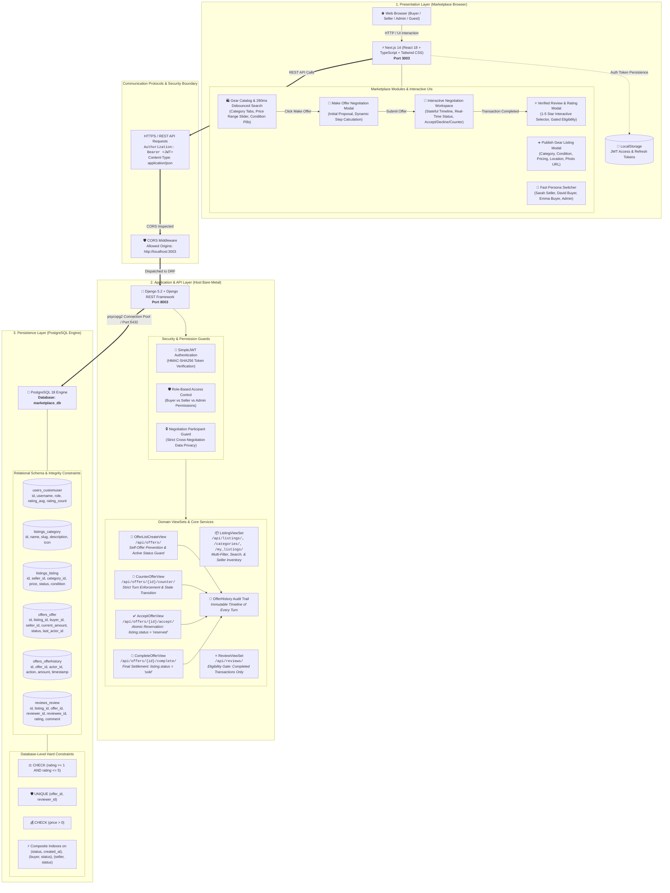
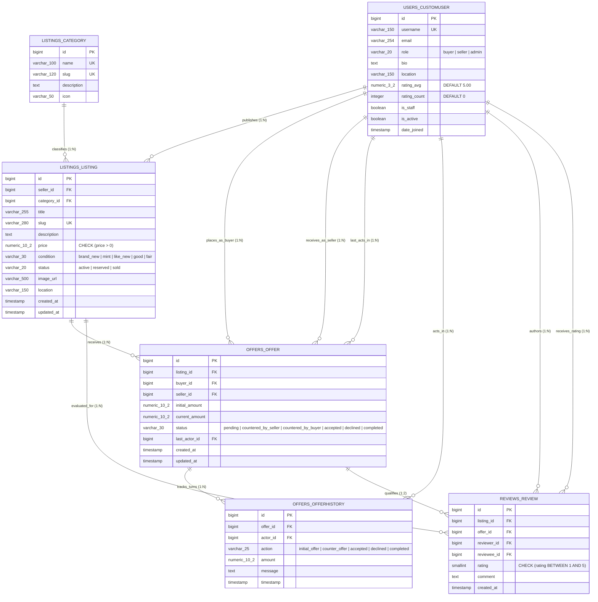

# FALCONXOFT WEEKEND 1 — PROJECT 03 (MARKETPLACE) LUCIDCHART DIAGRAM CODES

**Author:** Talha Ahmed  
**Evaluation Role:** Full-Stack Intern Performance Evaluation (Weekend 1)  
**Deliverable Reference:** Weekend Assignment.pdf §3  
**Status:** 100% Validated & Lucidchart-Ready  
**Live Editable Architecture:** [Open Architecture in Lucidchart](https://lucid.app/lucidchart/7cd41336-cdf3-4172-9aa0-4a06cf1144f5/edit?viewport_loc=-3684%2C-1045%2C12018%2C5829%2C0_0&invitationId=inv_1b126763-848c-4bec-b120-695dd90d94a4)  
**Live Editable Database ERD:** [Open Database ERD in Lucidchart](https://lucid.app/lucidchart/515dd05a-ebfc-4a3a-b732-609c2fb52c08/edit?viewport_loc=-595%2C441%2C3929%2C1906%2C0_0&invitationId=inv_7aa307bd-892a-4ff6-bd14-c274bb100d94)  
**Live Editable API Workflows Sequence:** [Open API Workflows in Lucidchart](https://lucid.app/lucidchart/168f1664-18bf-444f-9004-59fd18eb57ec/edit?view_items=~uEEJQnLJGcX&page=0_0&invitationId=inv_e4ad43d6-cb0a-4237-bdef-85be2905c002)

This document contains the exact, up-to-date Mermaid and SQL definitions for all 3 required diagrams in Project 03 (Two-Sided Marketplace — GearExchange). You can directly copy these codes and import them into Lucidchart via **File ➔ Import Data ➔ Mermaid** or **Entity Relationship ➔ Import SQL** with zero syntax errors.

---

## 1. System Architecture Diagram (`02 - architecture.pdf`)



---

## 2. Database ERD Diagram (`03 - database-design.pdf`)

### Option A: Mermaid ERD Code (Import via File ➔ Import Data ➔ Mermaid)



### Option B: PostgreSQL 18 Relational SQL DDL (Import via Shapes ➔ Entity Relationship ➔ Import)

```sql
CREATE TABLE users_customuser (
    id BIGSERIAL PRIMARY KEY,
    username VARCHAR(150) NOT NULL UNIQUE,
    email VARCHAR(254) NOT NULL,
    role VARCHAR(20) NOT NULL DEFAULT 'buyer',
    bio TEXT NOT NULL DEFAULT '',
    location VARCHAR(150) NOT NULL DEFAULT '',
    rating_avg NUMERIC(3, 2) NOT NULL DEFAULT 5.00,
    rating_count INTEGER NOT NULL DEFAULT 0,
    is_staff BOOLEAN NOT NULL DEFAULT FALSE,
    is_active BOOLEAN NOT NULL DEFAULT TRUE,
    date_joined TIMESTAMPTZ NOT NULL DEFAULT CURRENT_TIMESTAMP
);

CREATE TABLE listings_category (
    id BIGSERIAL PRIMARY KEY,
    name VARCHAR(100) NOT NULL UNIQUE,
    slug VARCHAR(120) NOT NULL UNIQUE,
    description TEXT NOT NULL DEFAULT '',
    icon VARCHAR(50) NOT NULL DEFAULT 'tag'
);

CREATE TABLE listings_listing (
    id BIGSERIAL PRIMARY KEY,
    seller_id BIGINT NOT NULL REFERENCES users_customuser(id) ON DELETE CASCADE,
    category_id BIGINT NOT NULL REFERENCES listings_category(id) ON DELETE RESTRICT,
    title VARCHAR(255) NOT NULL,
    slug VARCHAR(280) NOT NULL UNIQUE,
    description TEXT NOT NULL,
    price NUMERIC(10, 2) NOT NULL CHECK (price > 0),
    condition VARCHAR(30) NOT NULL DEFAULT 'like_new',
    status VARCHAR(20) NOT NULL DEFAULT 'active',
    image_url VARCHAR(500) NOT NULL DEFAULT '',
    location VARCHAR(150) NOT NULL DEFAULT 'US',
    created_at TIMESTAMPTZ NOT NULL DEFAULT CURRENT_TIMESTAMP,
    updated_at TIMESTAMPTZ NOT NULL DEFAULT CURRENT_TIMESTAMP
);

CREATE TABLE offers_offer (
    id BIGSERIAL PRIMARY KEY,
    listing_id BIGINT NOT NULL REFERENCES listings_listing(id) ON DELETE CASCADE,
    buyer_id BIGINT NOT NULL REFERENCES users_customuser(id) ON DELETE CASCADE,
    seller_id BIGINT NOT NULL REFERENCES users_customuser(id) ON DELETE CASCADE,
    initial_amount NUMERIC(10, 2) NOT NULL CHECK (initial_amount > 0),
    current_amount NUMERIC(10, 2) NOT NULL CHECK (current_amount > 0),
    status VARCHAR(30) NOT NULL DEFAULT 'pending',
    last_actor_id BIGINT REFERENCES users_customuser(id) ON DELETE SET NULL,
    created_at TIMESTAMPTZ NOT NULL DEFAULT CURRENT_TIMESTAMP,
    updated_at TIMESTAMPTZ NOT NULL DEFAULT CURRENT_TIMESTAMP
);

CREATE TABLE offers_offerhistory (
    id BIGSERIAL PRIMARY KEY,
    offer_id BIGINT NOT NULL REFERENCES offers_offer(id) ON DELETE CASCADE,
    actor_id BIGINT NOT NULL REFERENCES users_customuser(id) ON DELETE CASCADE,
    action VARCHAR(25) NOT NULL,
    amount NUMERIC(10, 2) NOT NULL,
    message TEXT NOT NULL DEFAULT '',
    timestamp TIMESTAMPTZ NOT NULL DEFAULT CURRENT_TIMESTAMP
);

CREATE TABLE reviews_review (
    id BIGSERIAL PRIMARY KEY,
    listing_id BIGINT NOT NULL REFERENCES listings_listing(id) ON DELETE CASCADE,
    offer_id BIGINT NOT NULL REFERENCES offers_offer(id) ON DELETE CASCADE,
    reviewer_id BIGINT NOT NULL REFERENCES users_customuser(id) ON DELETE CASCADE,
    reviewee_id BIGINT NOT NULL REFERENCES users_customuser(id) ON DELETE CASCADE,
    rating SMALLINT NOT NULL CHECK (rating >= 1 AND rating <= 5),
    comment TEXT NOT NULL,
    created_at TIMESTAMPTZ NOT NULL DEFAULT CURRENT_TIMESTAMP,
    CONSTRAINT unique_offer_reviewer UNIQUE (offer_id, reviewer_id)
);

CREATE INDEX idx_listings_status_created ON listings_listing(status, created_at DESC);
CREATE INDEX idx_listings_category_status ON listings_listing(category_id, status);
CREATE INDEX idx_offers_buyer_status ON offers_offer(buyer_id, status);
CREATE INDEX idx_offers_seller_status ON offers_offer(seller_id, status);
CREATE INDEX idx_offers_listing_status ON offers_offer(listing_id, status);
```

---

## 3. API Sequence Workflows (`04 - api-workflows.pdf`)

```mermaid
%% =============================================================================
%% FALCONXOFT INTERN EVALUATION — PROJECT 03: TWO-SIDED MARKETPLACE
%% API Sequence Workflows (Lucidchart / Mermaid Compatible)
%% Counter-Offer Negotiation, Atomic Reservation, Settlement, & Verified Reviews
%% Candidate: Talha Ahmed | Date: October 2026
%% =============================================================================

sequenceDiagram
    autonumber
    actor Buyer as Buyer (Next.js 14)
    actor Seller as Seller (Gear Owner)
    participant API as DRF Marketplace API (Port 8003)
    participant DB as PostgreSQL 18 (marketplace_db)

    %% -------------------------------------------------------------------------
    %% PART 1: COMPLETE NEGOTIATION & SETTLEMENT SUCCESS PATH
    %% -------------------------------------------------------------------------
    rect rgb(240, 253, 244)
        Note over Buyer, DB: PART 1: COMPLETE NEGOTIATION SUCCESS (Initial Offer to Final Settlement)

        Buyer->>API: POST /api/offers/ (listing_id: 1, amount: 1850.00, message: "Initial offer on Moog synth")
        API->>DB: SELECT * FROM listings_listing WHERE id = 1
        DB-->>API: Listing Found (status: active, seller_id: 2, price: 2200.00)
        
        Note over API: Validation: buyer_id (1) != seller_id (2) and listing is active
        API->>DB: INSERT INTO offers_offer (initial_amount: 1850, current_amount: 1850, status: pending, last_actor: 1)
        DB-->>API: Offer Created (id: 101)
        API->>DB: INSERT INTO offers_offerhistory (offer_id: 101, actor: 1, action: initial_offer, amount: 1850)
        DB-->>API: Audit Record Persisted
        API-->>Buyer: HTTP 201 Created (Offer Pending Seller Review)

        Seller->>API: POST /api/offers/101/counter/ (amount: 2000.00, message: "Includes original flight case")
        API->>DB: SELECT * FROM offers_offer WHERE id = 101
        DB-->>API: Offer Record (status: pending, last_actor: 1)
        
        Note over API: Turn Check: user (2) != last_actor (1) - Valid counter move!
        API->>DB: UPDATE offers_offer SET current_amount = 2000, status = countered_by_seller, last_actor = 2
        DB-->>API: Offer Updated
        API->>DB: INSERT INTO offers_offerhistory (offer_id: 101, actor: 2, action: counter_offer, amount: 2000)
        DB-->>API: Audit Record Persisted
        API-->>Seller: HTTP 200 OK (Counter-Offer Dispatched to Buyer)

        Buyer->>API: POST /api/offers/101/accept/
        API->>DB: SELECT * FROM offers_offer WHERE id = 101
        DB-->>API: Offer Record (status: countered_by_seller, last_actor: 2)
        
        Note over API, DB: BEGIN transaction.atomic()
        API->>DB: UPDATE offers_offer SET status = accepted WHERE id = 101
        API->>DB: UPDATE listings_listing SET status = reserved WHERE id = 1
        API->>DB: INSERT INTO offers_offerhistory (offer_id: 101, actor: 1, action: accepted, amount: 2000)
        DB-->>API: Listing Reserved and Agreement Sealed
        Note over API, DB: COMMIT transaction.atomic()
        API-->>Buyer: HTTP 200 OK (Offer Accepted - Listing Reserved)

        Buyer->>API: POST /api/offers/101/complete/
        API->>DB: SELECT * FROM offers_offer WHERE id = 101
        DB-->>API: Offer Record (status: accepted)
        
        Note over API, DB: BEGIN transaction.atomic()
        API->>DB: UPDATE offers_offer SET status = completed WHERE id = 101
        API->>DB: UPDATE listings_listing SET status = sold WHERE id = 1
        API->>DB: INSERT INTO offers_offerhistory (offer_id: 101, actor: 1, action: completed, amount: 2000)
        DB-->>API: Transaction Finalized
        Note over API, DB: COMMIT transaction.atomic()
        API-->>Buyer: HTTP 200 OK (Transaction Completed - Review Unlocked)
    end

    %% -------------------------------------------------------------------------
    %% PART 2: VERIFIED REVIEWS & REPUTATION ENGINE
    %% -------------------------------------------------------------------------
    rect rgb(254, 243, 199)
        Note over Buyer, DB: PART 2: VERIFIED REVIEWS AND REPUTATION ENGINE

        Buyer->>API: POST /api/reviews/ (offer_id: 101, rating: 5, comment: "Synth in pristine condition!")
        API->>DB: SELECT * FROM offers_offer WHERE id = 101
        DB-->>API: Offer Record (status: completed, buyer: 1, seller: 2)
        
        Note over API: Eligibility Check: user is legitimate party and status is completed
        API->>DB: INSERT INTO reviews_review (offer_id: 101, reviewer: 1, reviewee: 2, rating: 5)
        DB-->>API: Review Persisted
        API->>DB: SELECT AVG(rating), COUNT(id) FROM reviews_review WHERE reviewee_id = 2
        DB-->>API: rating_avg: 5.00, rating_count: 8
        API->>DB: UPDATE users_customuser SET rating_avg = 5.00, rating_count = 8 WHERE id = 2
        DB-->>API: Seller Reputation Updated
        API-->>Buyer: HTTP 201 Created (Verified Review Published)

        Buyer->>API: POST /api/reviews/ (Attempt duplicate review on offer_id: 101)
        API->>DB: INSERT INTO reviews_review (offer_id: 101, reviewer: 1)
        DB-->>API: Database UniqueConstraint(offer_id, reviewer_id) VIOLATION!
        API-->>Buyer: HTTP 400 Bad Request (Duplicate Review Prohibited)
    end

    %% -------------------------------------------------------------------------
    %% PART 3: FRAUD PREVENTION & TURN ENFORCEMENT DEFENSE
    %% -------------------------------------------------------------------------
    rect rgb(254, 226, 226)
        Note over Buyer, DB: PART 3: FRAUD PREVENTION AND TURN ENFORCEMENT DEFENSE

        Seller->>API: POST /api/offers/ (Attempt offer on own listing id: 1)
        API-->>Seller: HTTP 400 Bad Request (You cannot make an offer on your own listing)

        Buyer->>API: POST /api/offers/101/counter/ (Attempt back-to-back counter without seller reply)
        API->>DB: SELECT last_actor FROM offers_offer WHERE id = 101
        DB-->>API: last_actor = buyer
        Note over API: Violation: User is already last_actor - must await counter-party!
        API-->>Buyer: HTTP 400 Bad Request (Awaiting response from counter-party)

        Buyer->>API: POST /api/offers/101/counter/ (Attempt counter on completed offer)
        API-->>Buyer: HTTP 400 Bad Request (Cannot counter an offer that is already completed)
    end
```



---

## 4. Quick Lucidchart Import Instructions

1. **Architecture Diagram:**
   - Go to [Lucidchart](https://lucid.app) ➔ Create Blank Document.
   - Click **File ➔ Import Data ➔ Mermaid**.
   - Copy Section 1 above and paste it. Click **Import**.
   - Export: **File ➔ Export ➔ PDF** (`02 - architecture.pdf`) & **PNG** (`02 - architecture.png`).

2. **Database ERD:**
   - Create a new document in Lucidchart.
   - Click **File ➔ Import Data ➔ Mermaid** and paste Section 2 Option A (or paste SQL into Entity Relationship import).
   - Export: **File ➔ Export ➔ PDF** (`03 - database-design.pdf`) & **PNG** (`03 - database-design.png`).

3. **API Workflows Sequence:**
   - Create a new document in Lucidchart.
   - Click **File ➔ Import Data ➔ Mermaid**.
   - Copy Section 3 above and paste it. Click **Import**.
   - Export: **File ➔ Export ➔ PDF** (`04 - api-workflows.pdf`) & **PNG** (`04 - api-workflows.png`).
